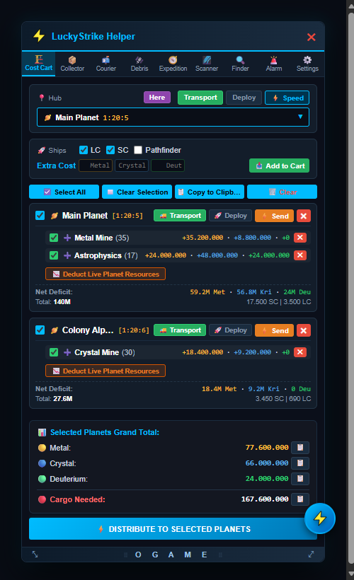
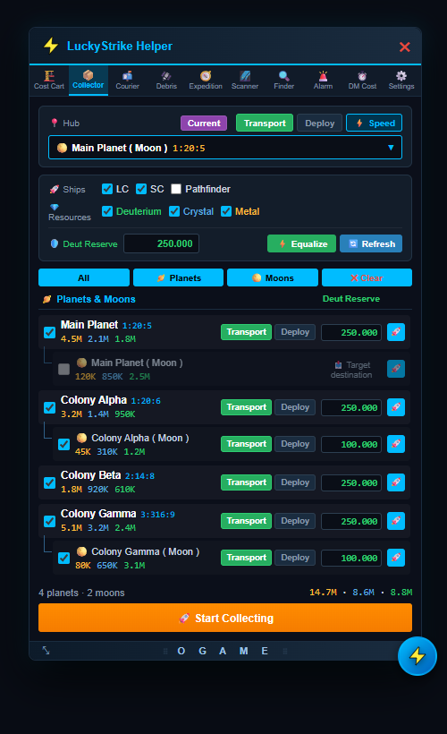
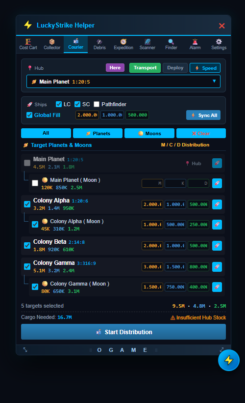
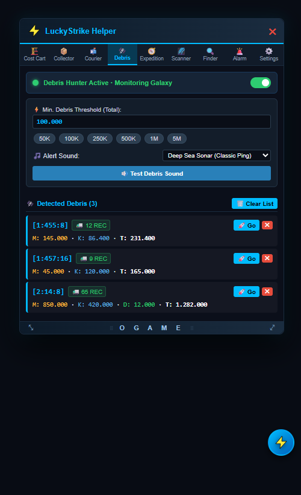
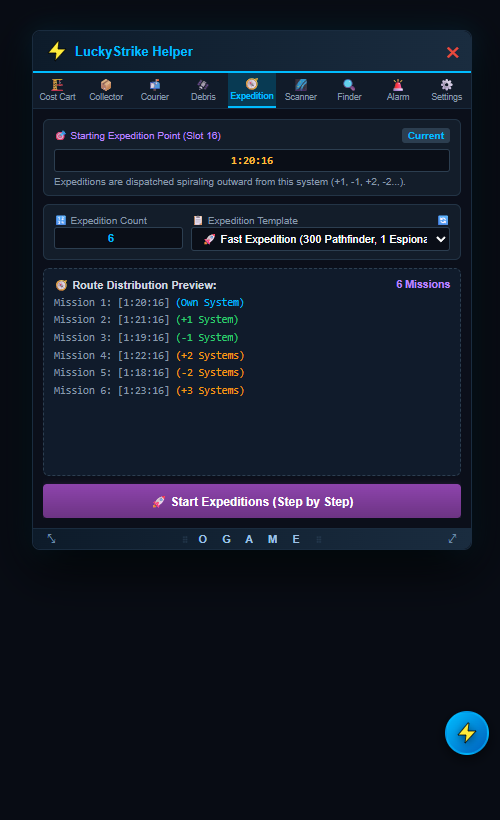
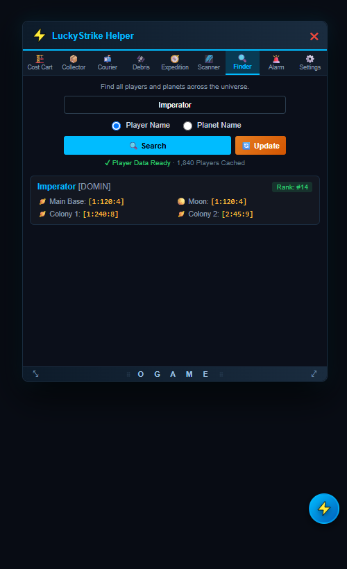
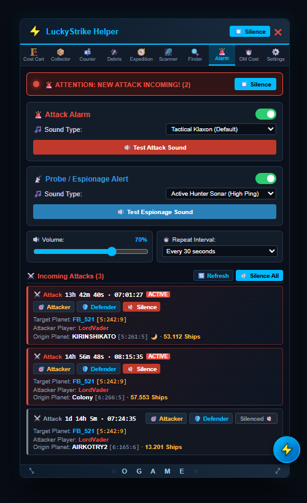
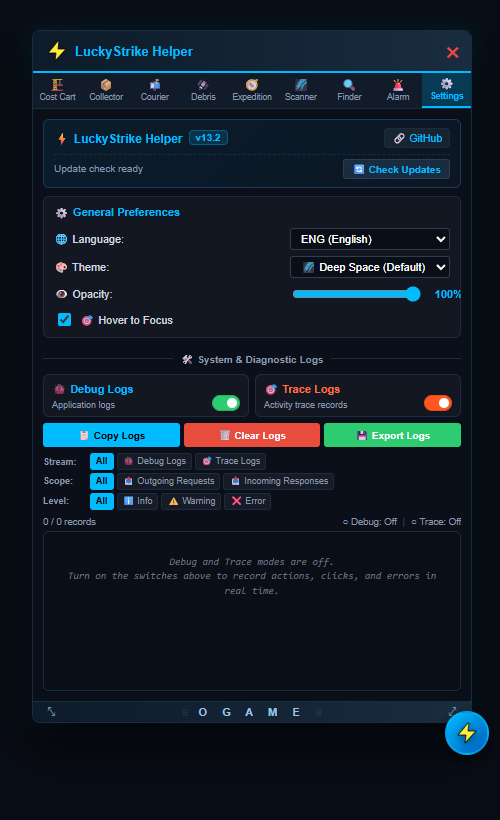

# ⚡ LuckyStrike OGame Helper (v14.6)

[English](#-english-description) | [Türkçe](#-türkçe-açıklama)

---

## 🇹🇷 Türkçe Açıklama

**LuckyStrike OGame Helper**, OGame oyuncuları için günlük filo ve hammadde hesaplamalarını, maliyet planlamasını, kargo gereksinimlerini ve evren takibini kolaylaştırmak üzere tasarlanmış, **Gameforge oyun kurallarına tam uyumlu** bir kullanıcı arayüzü ve hesaplama asistanıdır (**Chrome / Edge Extension - Manifest V3**).

### 🛡️ Oyun Kurallarına Tam Uyum & Hesaplama Asistanı Felsefesi
LuckyStrike OGame Helper, **Gameforge Kullanım Şartları ve Oyun Kuralları (Kural 5: Otomasyon ve Bot Politikası)** titizlikle gözetilerek geliştirilmiştir:
- **Tamamen Oyuncu Kontrollü (Sıfır Tam Otomasyon):** Eklenti kendi kendine, arka planda veya oyuncu bilgisayar başında yokken hiçbir işlem yapmaz. Filoları arka planda bağımsız göndermez, bina veya araştırma emri vermez. Her işlem bizzat oyuncunun gözü önünde, şeffaf şekilde ve oyuncunun tetiklemesiyle gerçekleşir.
- **Hesaplayıcı ve Ergonomi Yardımcısı (Calculator & QoL):** Tıpkı popüler simülasyon ve keşif hesaplama araçları gibi çalışır. Asıl görevi; gereken kargo kapasitelerini, hammadde açıklarını ve hedef koordinatları matematiksel olarak hesaplayıp ilgili form alanlarına hazır getirmektir. Oyuncunun normalde onlarca farklı menüye girerek tek tek yapacağı hesaplamaları pratikleştirir; her filo gönderimi oyuncunun bizzat `Space` (Boşluk) tuşuna basmasıyla veya butona tıklamasıyla insan hızında ve tek tek onaylanır.
- **Pasif Ekran Okuma:** Eklenti sunucuya yapay istek yükü bindirmez. Yalnızca oyuncu sayfalar arasında gezinirken veya tarayıcı sekmesi güncellendiğinde ekrandaki mevcut verileri pasif olarak okur.
- **Resmi Gameforge API Altyapısı:** Evren analizi ve oyuncu arama modülleri, Gameforge'un eklenti ve araç geliştiricileri için kamuya açık olarak sağladığı resmi XML API altyapısını (`/api/universe.xml`, `/api/players.xml`) 24 saatlik istemci önbelleği ve istek kilidiyle kullanır.
- **İstemci Taraflı ve Gizlilik Odaklı:** Hiçbir kullanıcı şifresi, hesap detayı veya oyun verisi harici sunuculara aktarılmaz; tüm hesaplamalar ve kullanıcı tercihleri yalnızca yerel tarayıcı belleğinizde tutulur.

---

### 🌟 Oynanışı Kolaylaştıran Modüller & 9 Sekme

#### 1. 🏗️ Maliyet Sepeti & Çoklu Kademe Hesabı

  

- **Çoklu Kademe Seçimi:** Bina veya araştırma detayına tıklandığında `[ − ] [ +N ] [ + ]` seçimi ve tek tıkla sepete ekleme.
- **Resmi Gameforge LFMaster Tablosu:** 4 ırkın (Rock'tal, İnsan, Mecha, Kaelesh) 48 binası ve 72 araştırması dahil tüm kademelerin hammadde maliyetlerini eksiksiz doğrulukla hesaplar.
- **Mevcut Kaynağı Düş:** Gezegende bulunan anlık hammadde stoklarını sepetten düşerek net açığı gösterir.
- **Nakliye Filosu İhtiyacı:** Kalan açık için gereken Küçük Nakliye (KN) ve Büyük Nakliye (BN) sayısını anında hesaplar.
- **Çoklu Gezegen Gruplama & Tek Tuşla Dağıtım (`Space`):** Farklı gezegenlerdeki bina ve araştırmaları tek listede toplar; eksik kaynakları ve hedef koordinatları otomatik yükleyerek `Space` tuşu ile sıra sıra güvenle yola çıkarır.

---

#### 2. 📦 Maden Toplayıcı Asistanı (Resource Collector)

  

- **İmparatorluk Çapında Pratik Toplama:** Seçilen tüm gezegen ve aylardan belirlenen merkez noktaya (gezegen, ay veya manuel koordinat) madenleri sıra sıra toplar.
- **Hızlı Üs Seçimi & "Burası" Butonu:** Toplama hedefi açılır listesinden (combobox) istenen üs seçilebilir veya `Burası` butonuna tıklanarak bulunulan gezegen/ay tek tıkla hedef atanabilir.
- **Güvenli Deuterium Rezervi:** Her gezegen için harcanmayacak minimum Deuterium koruma rezervi tanımlanabilir.
- **Akıllı Filo & Görev Seçimi:** Büyük Nakliye (BN), Küçük Nakliye (KN) ve Rehber gemi dağılımı otomatik yapılır; **Nakliye** veya **Konuşlandır** görevi seçilebilir.
- **Yüzen Bilgi Paneli & Space Desteği:** Ekranın üstünde çıkan bilgi panelinden rota ve taşınan madenler anlık izlenir; `Space` tuşu ile sıra sıra filolar güvenle gönderilir. Bağlantı gecikmelerinde `🔄 Tekrarla` butonuyla adımı sırayı bozmadan yeniden deneme imkanı sunar.

---

#### 3. 📬 Postacı Asistanı (Resource Courier)

  

- **Merkezi Dağıtım Modeli:** Maden Toplayıcı'nın ters yönlü simetriği olarak çalışır; tek bir çıkış üssünden (Dağıtım Üssü) seçilen hedef gezegen ve aylara maden sevkiyatı yapar.
- **Açılır Liste (Combobox) & "Burası" Desteği:** Dağıtım üssü kutusuna tıklanarak imparatorluktaki herhangi bir Gezegen veya Ay listeden seçilebilir ya da `Burası` butonuyla bulunulan üs anında merkez yapılabilir.
- **Genel Dağıtım Senkronizasyonu (`⚡ Eşitle`):** Üst alanda girilen Metal, Kristal ve Deuterium tutarlarını tek tıkla tüm seçili hedeflere otomatik uygular.
- **Hedefe Özel Bağımsız Giriş:** Her koloninin yanındaki 3 kutudan (M / K / D) bağımsız tutarlar girilebilir; `1m`, `500k`, `2.5m` gibi sayı kısaltmaları desteklenir.
- **Canlı Stok & Kargo Doğrulaması:** Dağıtım üssündeki hammadde varlığı ve seçilen kargo gemilerinin kapasitesi anlık taranarak stok yetersizliğinde uyarı verir.
- **Otomatik Uncheck & Sıralı Space Gönderimi:** Filosu yola çıkan her hedef otomatik olarak listeden kaldırılır (`uncheck`); mükerrer gönderim riski olmadan `Space` tuşuyla sıralı dağıtım yapılır.

---

#### 4. 🛰️ Harabe Alanı Takipçisi (Debris Tracker)

  

- **Galakside Gezinirken Pasif Okuma:** Oyuncu galaksi sayfasında gezinirken, ekranda o an görüntülenen harabeleri listeye derler ve gözden kaçmasını önler.
- **16. Slot Harabeleri:** Keşif harabelerini (Sonsuz Uzaklar) listeye otomatik dahil eder.
- **Sesli Bildirim ve Eşik Ayarı:** Belirlenen kaynak eşiğinin (örn: 100K, 250K, 1M, 5M) üzerindeki harabeler için sesli uyarı imkanı sunar.
- **Geri Dönüşümcü (GD) Hesabı:** Toplam hammaddeye göre gereken GD sayısını ekranda hesaplayarak roket simgeli butonla galaksiye pratik yönlendirme sağlar.

---

#### 5. 🧭 Keşif Asistanı (Expedition Assistant)

  

- **Spiral Keşif Algoritması:** Belirlenen başlangıç sisteminden başlayarak yakından uzağa doğru spiral (+1, -1, +2, -2...) olarak 16. slotlara rota oluşturur.
- **Doğal Şablon Entegrasyonu:** OGame Filo 1 sayfasındaki "Keşif filosu" şablonlarını otomatik algılar; kayıtlı gemi bileşimi ve filo hızlarını koruyarak doğrudan uygular.
- **Rota Dağılım Önizlemesi:** Kaçıncı seferin hangi sisteme gideceğini renkli rota haritasıyla panelde gösterir.
- **Yüzen Bilgi Paneli & Adım Adım Space Desteği:** Filoyu hazırlar, `Space` tuşu ile sırayla tüm seferleri kesintisiz yola çıkarır; takılmalarda `🔄 Tekrarla` ile adımı yeniler.

---

#### 6. 🌌 Galaxy Scanner (Boş Slot & Sistem Arayıcı)

  

- **Resmi Gameforge API Verisi:** Kamuya açık `universe.xml` verisini kullanarak boş slotları ve grupça ışınlanmaya uygun sistemleri listeler.
- **Sıfır Sunucu Yükü & Akıllı Önbellek:** 24 saat geçerli istemci önbelleği sayesinde taramalar ~50 ms içinde yerel hafızadan tamamlanır.
- **60 Saniye Güvenlik Kilidi:** API spamını önlemek için `🔄 Güncelle` butonunda senkronize geri sayım sayacı çalışır.
- **Hedef Slot Filtreleri:** Sadece 8 (Maksimum Metal), 7-9, 13-15 (Deuterium), 1-3 (Güneş) veya Tamamen Boş (1-15) gibi hızlı çipler sunar.

---

#### 7. 🔍 Player Finder (Oyuncu & Gezegen Arama)

  

- **Oyuncu ve Koloni Konumları:** Resmi `players.xml` ve `universe.xml` API'si üzerinden oyuncu adı veya gezegen adına göre anında arama yapar.
- **İttifak ve Sıralama Bilgisi:** Oyuncunun ittifak etiketini, sıralamasını ve tüm gezegen/ay koordinatlarını düzenli bir kart halinde listeler.
- **Ortak Önbellek Senkronizasyonu:** Galaxy Scanner ile ortak önbellek altyapısını kullanır; tek bir güncelleme ile tüm evren verisi güncel kalır.

---

#### 8. 🚨 Tehdit Bildirimi & Alarm (Active Threat Alert)

  

- **Aktif Oyun Oturumunda Ekrana Duyarlı:** Oyuncu oyunu oynarken, sayfa yenilendiğinde veya OGame'in üst etkinlik çubuğu güncellendiğinde ekrandaki kırmızı/mavi tehdit durumunu okur.
- **Özelleştirilebilir Saldırı Sesleri:** Taktiksel Klakson, Kırmızı Alarm Sireni veya Acil Durum Nabzı arasından ses seçimi.
- **Casusluk / Sonda Sesleri:** Derin Deniz Sonarı (Klasik Ping), Aktif Avcı Sonarı (Yüksek Ping) veya Taktik Yankı Sonarı.
- **Ses Seviyesi & Tekrar Sıklığı:** %0-%100 ses kaydırıcısı ve tek seferlik, 5s, 10s, 15s, 30s, 60s periyot seçenekleri.
- **Tek Tıkla Sustur Butonu:** Başlık çubuğunda ve sekme içinde çalan alarmı anında susturma butonu (`⏹️ Sustur`).

---

#### 9. ⚙️ Ayarlar, Özelleştirme & Sistem Teşhis Günlükleri

  

- **🌐 Dil Seçimi (Language):** TR (Türkçe) ve ENG (English) seçenekleri.
- **🎨 Görünüm / Tema:** Uzay Karanlığı (Dark Space) karanlık tema tasarımı.
- **👁️ Ayarlanabilir Saydamlık (Opacity Slider):** %20 ile %100 arasında panel şeffaflığı belirleme imkanı.
- **🎯 Fare Focus Özelliği (Hover to Focus):** Panel saydamken fare üzerine geldiğinde otomatik %100 görünürlük, fare çekildiğinde eski şeffaflığa yumuşak dönüş.
- **🛠️ Gelişmiş Sistem & Teşhis Günlükleri (Debug & Trace Logs):**
  - **3 Satırlı Gelişmiş Multi-Filtre (AND Mantığı):** Akış (Tümü, Debug, Trace), Kapsam (Giden İstekler, Gelen Yanıtlar), Seviye (Info, Warning, Error).
  - **Logları Çıkar (.txt):** Zaman damgalı metin dosyası olarak masaüstüne indirme diyaloğu.
  - **Filtreye Duyarlı Kopyalama ve Temizleme:** Sadece seçili kriterlere uyan kayıtları panoya kopyalama veya temizleme.

---

### ⏱️ Sekmeler İçin 3 Saniye Kullanım Rehberi (Hover Tooltips)
Panel üzerindeki 9 sekmenin (`Maliyet`, `Toplayıcı`, `Postacı`, `Harabe`, `Keşif`, `Tarayıcı`, `Arama`, `Alarm`, `Ayarlar`) üzerine fare ile gelinip **3 saniye** beklendiğinde, o sekmenin ne işe yaradığını ve nasıl kullanılacağını anlatan Türkçe/İngilizce ipucu kutusu (tooltip) belirir; fare çekildiğinde otomatik kaybolur.

---

### ⌨️ Tek Tuşla Filo Gönderimi (`Space` Tuşu Akışı)
LuckyStrike, filo hazırlığı gerektiren tüm ana modüllerde (**Maliyet Sepeti**, **Maden Toplayıcı**, **Postacı Asistanı** ve **Keşif Asistanı**) standartlaştırılmış bir yüzen HUD banner'ı kullanır:
1. Gerekli kargo gemilerini, hammadde tutarlarını ve hedef koordinatları otomatik olarak forma yazar.
2. Formu Filo 2 (onay) ekranına taşır.
3. Ekranın üstünde çıkan parlak bilgi panelinde rota ve maden bilgisi özetlenir.
4. Oyuncu yalnızca klavyedeki **`Space` (Boşluk)** tuşuna basarak (veya butona tıklayarak) filoyu güvenle yola çıkarır.

---

## 🇬🇧 English Description

**LuckyStrike OGame Helper** is a browser assistant (**Chrome / Edge Extension - Manifest V3**) designed for OGame players to assist with daily calculations, resource planning, cargo capacity estimation, and universe tracking while strictly complying with **Gameforge Fair-Play Rules**.

### 🛡️ Fair-Play Rules Compliance & Calculation Philosophy
LuckyStrike OGame Helper is engineered with strict adherence to **Gameforge Terms & Conditions (Rule 5: Automation & Bot Policy)**:
- **100% Player-Driven (Zero Full Automation):** The extension never operates independently, in the background, or without the player present. It does not dispatch fleets autonomously, nor does it queue buildings or research orders. Every single action is fully transparent and initiated by the player on screen.
- **Calculator & Quality of Life (QoL) Assistant:** Operates on the same principle as community-approved simulation calculators and expedition planners. Its core purpose is calculating required cargo capacities, resource deficits, and destination coordinates, then pre-filling standard form inputs. Instead of manually cross-referencing numbers across multiple menus, the player dispatches each fleet individually at normal human pace by pressing the `Space` key (or clicking the button).
- **Passive On-Screen Reading:** Generates zero unnecessary server load. It strictly inspects existing DOM elements when the player actively navigates pages or when game events naturally update.
- **Official Gameforge Public APIs:** Galaxy and player analysis modules leverage official public XML endpoints (`/api/universe.xml`, `/api/players.xml`) provided for community tool developers, complete with 24-hour client caching and request throttling.
- **Client-Side & Privacy-First:** No personal credentials, passwords, or game data are ever transmitted to third-party servers. All calculations and settings remain strictly within your local browser storage.

---

### 🌟 Gameplay Convenience Features & 9 Tabs

#### 1. 🏗️ Resource Cost Cart & Multi-Level Calculation

  

- **Multi-Level Selection:** Quick level adjustments (`[ − ] [ +N ] [ + ]`) directly within building and research detail popups.
- **Official Gameforge LFMaster Table:** Accurately calculates resource costs for all structures, researches, and Lifeform buildings (48 buildings, 72 researches across all 4 races).
- **Deduct Live Resources:** Subtracts live resources stored on the current planet/moon to display the exact deficit.
- **Cargo Ship Requirements:** Instantly calculates required Small Cargo (KN) and Large Cargo (BN) counts.
- **Multi-Planet Grouping & Spacebar Dispatch:** Combines items across different colonies in a single view; autofills ships, resources, and coordinates with seamless `Space` key dispatch.

---

#### 2. 📦 Resource Collector Assistant

  

- **Empire-Wide Collection:** Sequentially gathers resources from all selected planets and moons to a designated central base (planet, moon, or manual coordinate).
- **Quick Target Selection & "Here" Button:** Choose target base from the combobox dropdown or click `Here` to instantly set the active colony as target.
- **Protected Deuterium Reserves:** Configure custom minimum deuterium reserves per colony to preserve fleet flight fuel.
- **Smart Ship & Mission Selection:** Distributes Large Cargo, Small Cargo, and Pathfinders automatically; supports both **Transport** and **Deploy** missions.
- **Floating HUD & Spacebar Dispatch:** Real-time route and cargo status displayed on a top banner; send fleets step-by-step with `Space`. Includes a `🔄 Retry` button to reattempt steps during connection hiccups without breaking queue order.

---

#### 3. 📬 Resource Courier Assistant

  

- **Central Distribution Model:** Operates as the reverse of the Collector; dispatches resources from a single origin base (Distribution Hub) outward to selected colonies.
- **Combobox Dropdown & "Here" Support:** Set the origin base via the interactive dropdown or click `Here` to assign the current planet or moon.
- **Global Amount Sync (`⚡ Sync`):** Input Metal, Crystal, and Deuterium amounts once and apply them across all selected targets with a single click.
- **Colony Overrides & Shorthand Formats:** Enter distinct custom amounts for any colony using compact abbreviations like `1m`, `500k`, `2.5m`.
- **Live Stock & Capacity Verification:** Inspects origin storage and selected cargo fleet capacity on the fly; warns if origin inventory is insufficient.
- **Automatic Uncheck & Sequential Spacebar Dispatch:** Each successfully dispatched destination is automatically unchecked from the list; progress seamlessly through the queue using `Space`.

---

#### 4. 🛰️ Debris Field Tracker

  

- **Passive Galaxy View Tracking:** Compiles and organizes debris fields displayed on screen as you navigate galaxy systems.
- **Slot 16 Support:** Captures expedition debris (Endless Expanse) into the active list.
- **Audio Alerts & Threshold Filter:** Set custom resource thresholds (50K, 100K, 250K, 500K, 1M, 5M) with audible alerts when valuable debris is spotted.
- **Recycler Counter:** Displays required Recycler count and provides a quick rocket button to jump to the galaxy system.

---

#### 5. 🧭 Expedition Assistant

  

- **Spiral Routing Algorithm:** Distributes expedition missions to slot 16 systems radiating outward (+1, -1, +2, -2...) from your chosen origin.
- **Native Template Detection:** Automatically reads native OGame Fleet 1 expedition templates, preserving your saved ship compositions and speeds.
- **Visual Route Preview:** Displays an indexed, color-coded breakdown of upcoming expedition targets.
- **Floating HUD & Spacebar Dispatch:** Prepares Fleet 2 and advances through missions sequentially with `Space`; retry stuck steps with `🔄 Retry`.

---

#### 6. 🌌 Galaxy Scanner (Empty Slot Locator)

  

- **Official Gameforge API:** Leverages public `universe.xml` data to locate vacant slots and clusters of systems suitable for colonization or relocation.
- **Zero Server Overhead & 24h Cache:** Queries complete in ~50 ms from local client storage without generating repeated network requests.
- **60-Second Cooldown Lock:** Prevents accidental API flooding with synchronized countdown timers on refresh actions.
- **Target Slot Chips:** Quick filters for Slot 8 (Max Metal), 7-9, 13-15 (Deuterium), 1-3 (Solar), or Fully Vacant Systems (1-15).

---

#### 7. 🔍 Player Finder (Colony Locator)

  

- **Player & Planet Coordinate Search:** Searches player names and colony names via official `players.xml` and `universe.xml` APIs.
- **Alliance & Ranking Overview:** Displays player alliance tags, rank positions, and complete coordinate lists in a clean card layout.
- **Shared Cache Synchronization:** Seamlessly shares cache data with the Galaxy Scanner, keeping data fresh without redundant downloads.

---

#### 8. 🚨 Threat Alert Assistant (Active In-Game Alarm)

  

- **Active Session Threat Detection:** Monitors incoming attacks and espionage missions when the active page refreshes or the game's native event header updates.
- **Customizable Attack Sounds:** Tactical Klaxon, Red Alert Siren, or Emergency Pulse.
- **Espionage Sonar Sounds:** Deep Sea Sonar (Classic Ping), Hunter Sonar (High Ping), or Tactical Echo Sonar.
- **Volume & Repeat Controls:** 0-100% volume slider and repeat frequencies (Once, 5s, 10s, 15s, 30s, 60s).
- **One-Click Mute:** Immediate silence button (`⏹️ Stop`) located both on the header bar and inside the tab.

---

#### 9. ⚙️ Settings, Customization & System Diagnostics

  

- **🌐 Language Selector:** Switch between TR (Türkçe) and ENG (English) instantly.
- **🎨 Skin & Theme:** Space Darkness (Dark Space) optimized theme.
- **👁️ Opacity Slider:** Fine-tune panel transparency between 20% and 100%.
- **🎯 Hover to Focus:** Automatically restores 100% opacity when hovering over the panel, smoothly returning to your transparent setting on mouse leave.
- **🛠️ Advanced System & Diagnostic Logs (Debug & Trace):**
  - **3-Row Multi-Filter (AND Logic):** Stream (All, Debug, Trace), Scope (Outbound Requests, Inbound Responses), Level (Info, Warning, Error).
  - **Export Logs (.txt):** Download timestamped diagnostic logs directly to your desktop.
  - **Filter-Aware Copy & Clear:** Copy or purge only the entries that match your currently applied filters.

---

### ⏱️ 3-Second Guidance Tooltips (Hover Tooltips)
Hovering your mouse over any of the 9 tabs (`Cart`, `Collector`, `Courier`, `Debris`, `Expedition`, `Scanner`, `Finder`, `Alarm`, `Settings`) for **3 seconds** reveals an educational tooltip explaining the purpose and usage of that module; it automatically dismisses when moving the mouse away.

---

### ⌨️ Single-Key Fleet Dispatch (`Space` Key Workflow)
LuckyStrike unifies all fleet preparation modules (**Cost Cart**, **Resource Collector**, **Resource Courier**, and **Expedition Assistant**) under a standardized floating HUD:
1. Automatically populates required cargo ships, resource quantities, and destination coordinates.
2. Advances the page to Fleet Step 2 (dispatch confirmation).
3. Displays a glowing top HUD banner summarizing the flight path and cargo payload.
4. The player confirms and dispatches the fleet simply by pressing **`Space`** on the keyboard (or clicking the button).

---

## 🚀 Kurulum / Installation

### Chrome & Microsoft Edge
1. İndirin / Download: [`luckystrike-ogame-helper-v14.6.zip`](https://github.com/kadirersoy/luckystrike-ogame-helper/releases/latest)
2. Tarayıcıda eklentiler sayfasına gidin / Open extensions page:
   - **Chrome:** `chrome://extensions`
   - **Edge:** `edge://extensions`
3. **"Geliştirici Modu" (Developer Mode)** seçeneğini açın.
4. ZIP'ten çıkardığınız klasörü **"Paketlenmemiş öğe yükle" (Load unpacked)** butonuyla seçin.

---

## 📜 Sürüm Notları / Release Notes

Detaylı sürüm geçmişi, tüm yenilikler ve hata düzeltmeleri her versiyon için iki dilde (🇹🇷 Türkçe ve 🇬🇧 English) doğrudan GitHub Releases sayfasında yayınlanmaktadır:
👉 **[GitHub Releases — Sürüm Notları / Release Notes](https://github.com/kadirersoy/luckystrike-ogame-helper/releases)**

For full release history, feature highlights, and bilingual changelogs (🇹🇷 Turkish & 🇬🇧 English), please visit the GitHub Releases page linked above.
