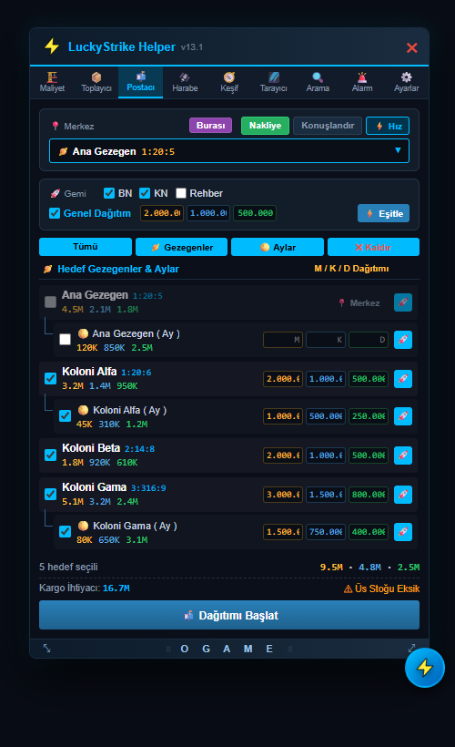
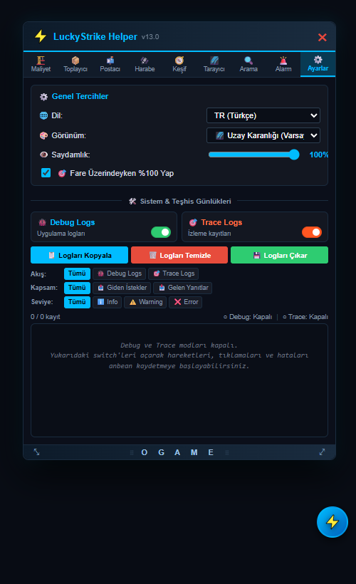

# ⚡ LuckyStrike OGame Helper (v12.2)

[English](#-english-description) | [Türkçe](#-türkçe-açıklama)

---

## 🇹🇷 Türkçe Açıklama

**LuckyStrike OGame Helper**, OGame oyuncuları için günlük imparatorluk yönetimini, hammadde planlamasını, filo nakliye hesaplamalarını ve bilgi takibini kolaylaştırmak üzere tasarlanmış, **Gameforge oyun kurallarına tam uyumlu** bir kullanıcı arayüzü asistanıdır (**Chrome / Edge Extension - Manifest V3**).

### 🛡️ Gameforge & OGame Oyun Kurallarına Uyumluluk
LuckyStrike OGame Helper, **Gameforge Kullanım Şartları ve Oyun Kuralları (Kural 5: Otomasyon ve Bot Politikası)** titizlikle gözetilerek geliştirilmiştir:
- **Sadece Oyuncu Başındayken ve Pasif Çalışır:** Eklenti kendi kendine sunucuya arka planda otomatik istek atmaz. Bilgi takibi ve güncellemeler, yalnızca **oyuncu bilgisayar başındayken**, sayfalar arasında gezinirken veya tarayıcı sekmesi güncellendiğinde ekrana gelen verileri okur.
- **Otomasyon / Bot İçermez:** Filoları arka planda gizlice göndermez, bina veya araştırma emri vermez. Kaynak doldurma ve filo hazırlama gibi kolaylaştırıcı işlemler yalnızca **oyuncunun bizzat butona tıklamasıyla** form alanlarına yazılır; son onay, gönderme (`Space` veya butona tıklama) ve karar kontrolü tamamen oyuncuya aittir.
- **Resmi Gameforge API Altyapısı:** Evren analizi ve oyuncu arama modülleri, Gameforge'un eklenti ve araç geliştiricileri için kamuya açık olarak sağladığı resmi XML API altyapısını (`/api/universe.xml`, `/api/players.xml`) 24 saatlik istemci önbelleği ve spam koruma kilidiyle kullanır.
- **İstemci Taraflı ve Gizlilik Odaklı:** Hiçbir kullanıcı verisi, şifresi veya oyun bilgisi harici sunuculara aktarılmaz; tüm tercihler yalnızca yerel tarayıcı belleğinizde saklanır.

---

### 🌟 Oynanışı Kolaylaştıran Modüller & 9 Sekme

#### 1. 🏗️ Maliyet Sepeti & Çoklu Kademe Hesabı

  

- **Çoklu Kademe Seçimi:** Bina veya araştırma detayına tıklandığında `[ − ] [ +N ] [ + ]` seçimi ve tek tıkla sepete ekleme.
- **Resmi Gameforge LFMaster Tablosu:** 4 ırkın (Rock'tal, İnsan, Mecha, Kaelesh) 48 binası ve 72 araştırması dahil tüm kademelerin hammadde maliyetlerini eksiksiz doğrulukla hesaplar.
- **Mevcut Kaynağı Düş:** Gezegende bulunan anlık hammadde stoklarını sepetten düşerek net açığı gösterir.
- **Nakliye Filosu İhtiyacı:** Kalan açık için gereken Küçük Nakliye (KN) ve Büyük Nakliye (BN) sayısını anında hesaplar.
- **Çoklu Gezegen Gruplama & Tek Tuşla Dağıtım (`Space`):** Farklı gezegenlerdeki bina ve araştırmaları tek listede toplar; eksik kaynakları ve hedef koordinatları otomatik yükleyerek `Space` tuşu ile sıra sıra güvenle yola çıkarır.

---

#### 2. 📦 Maden Toplayıcı Asistanı (Resource Collector)

  

- **İmparatorluk Çapında Pratik Toplama:** Seçilen tüm gezegen ve aylardan belirlenen merkez noktaya (gezegen, ay veya manuel koordinat) madenleri sıra sıra toplar.
- **Hızlı Üs Seçimi & "Burası" Butonu:** Toplama hedefi açılır listesinden (combobox) istenen üs seçilebilir veya `Burası` butonuna tıklanarak bulunulan gezegen/ay tek tıkla hedef atanabilir.
- **Güvenli Deuterium Rezervi:** Her gezegen için harcanmayacak minimum Deuterium koruma rezervi tanımlanabilir.
- **Akıllı Filo & Görev Seçimi:** Büyük Nakliye (BN), Küçük Nakliye (KN) ve Rehber gemi dağılımı otomatik yapılır; **Nakliye** veya **Konuşlandır** görevi seçilebilir.
- **Yüzen Bilgi Paneli & Space Desteği:** Ekranın üstünde çıkan bilgi panelinden rota ve taşınan madenler anlık izlenir; `Space` tuşu ile sıra sıra filolar güvenle gönderilir. Bağlantı gecikmelerinde `🔄 Tekrarla` butonuyla adımı sırayı bozmadan yeniden deneme imkanı sunar.

---

#### 3. 📬 Postacı Asistanı (Resource Courier)

  

- **Merkezi Dağıtım Modeli:** Maden Toplayıcı'nın ters yönlü simetriği olarak çalışır; tek bir çıkış üssünden (Dağıtım Üssü) seçilen hedef gezegen ve aylara maden sevkiyatı yapar.
- **Açılır Liste (Combobox) & "Burası" Desteği:** Dağıtım üssü kutusuna tıklanarak imparatorluktaki herhangi bir Gezegen veya Ay listeden seçilebilir ya da `Burası` butonuyla bulunulan üs anında merkez yapılabilir.
- **Genel Dağıtım Senkronizasyonu (`⚡ Eşitle`):** Üst alanda girilen Metal, Kristal ve Deuterium tutarlarını tek tıkla tüm seçili hedeflere otomatik uygular.
- **Hedefe Özel Bağımsız Giriş:** Her koloninin yanındaki 3 kutudan (M / K / D) bağımsız tutarlar girilebilir; `1m`, `500k`, `2.5m` gibi sayı kısaltmaları desteklenir.
- **Canlı Stok & Kargo Doğrulaması:** Dağıtım üssündeki hammadde varlığı ve seçilen kargo gemilerinin kapasitesi anlık taranarak stok yetersizliğinde uyarı verir.
- **Otomatik Uncheck & Sıralı Space Gönderimi:** Filosu yola çıkan her hedef otomatik olarak listeden kaldırılır (`uncheck`); mükerrer gönderim riski olmadan `Space` tuşuyla sıralı dağıtım yapılır.

---

#### 4. 🛰️ Harabe Alanı Takipçisi (Debris Tracker)

  

- **Galakside Gezinirken Pasif Okuma:** Oyuncu galaksi sayfasında gezinirken, ekranda o an görüntülenen harabeleri listeye derler ve gözden kaçmasını önler.
- **16. Slot Harabeleri:** Keşif harabelerini (Sonsuz Uzaklar) listeye otomatik dahil eder.
- **Sesli Bildirim ve Eşik Ayarı:** Belirlenen kaynak eşiğinin (örn: 100K, 250K, 1M, 5M) üzerindeki harabeler için sesli uyarı imkanı sunar.
- **Geri Dönüşümcü (GD) Hesabı:** Toplam hammaddeye göre gereken GD sayısını ekranda hesaplayarak roket simgeli butonla galaksiye pratik yönlendirme sağlar.

---

#### 5. 🧭 Keşif Asistanı (Expedition Assistant)

  

- **Spiral Keşif Algoritması:** Belirlenen başlangıç sisteminden başlayarak yakından uzağa doğru spiral (+1, -1, +2, -2...) olarak 16. slotlara rota oluşturur.
- **Doğal Şablon Entegrasyonu:** OGame Filo 1 sayfasındaki "Keşif filosu" şablonlarını otomatik algılar; kayıtlı gemi bileşimi ve filo hızlarını koruyarak doğrudan uygular.
- **Rota Dağılım Önizlemesi:** Kaçıncı seferin hangi sisteme gideceğini renkli rota haritasıyla panelde gösterir.
- **Yüzen Bilgi Paneli & Adım Adım Space Desteği:** Filoyu hazırlar, `Space` tuşu ile sırayla tüm seferleri kesintisiz yola çıkarır; takılmalarda `🔄 Tekrarla` ile adımı yeniler.

---

#### 6. 🌌 Galaxy Scanner (Boş Slot & Sistem Arayıcı)

  

- **Resmi Gameforge API Verisi:** Kamuya açık `universe.xml` verisini kullanarak boş slotları ve grupça ışınlanmaya uygun sistemleri listeler.
- **Sıfır Sunucu Yükü & Akıllı Önbellek:** 24 saat geçerli istemci önbelleği sayesinde taramalar ~50 ms içinde yerel hafızadan tamamlanır.
- **60 Saniye Güvenlik Kilidi:** API spamını önlemek için `🔄 Güncelle` butonunda senkronize geri sayım sayacı çalışır.
- **Hedef Slot Filtreleri:** Sadece 8 (Maksimum Metal), 7-9, 13-15 (Deuterium), 1-3 (Güneş) veya Tamamen Boş (1-15) gibi hızlı çipler sunar.

---

#### 7. 🔍 Player Finder (Oyuncu & Gezegen Arama)

  

- **Oyuncu ve Koloni Konumları:** Resmi `players.xml` ve `universe.xml` API'si üzerinden oyuncu adı veya gezegen adına göre anında arama yapar.
- **İttifak ve Sıralama Bilgisi:** Oyuncunun ittifak etiketini, sıralamasını ve tüm gezegen/ay koordinatlarını düzenli bir kart halinde listeler.
- **Ortak Önbellek Senkronizasyonu:** Galaxy Scanner ile ortak önbellek altyapısını kullanır; tek bir güncelleme ile tüm evren verisi güncel kalır.

---

#### 8. 🚨 Tehdit Bildirimi & Alarm (Active Threat Alert)

  

- **Aktif Oyun Oturumunda Ekrana Duyarlı:** Oyuncu oyunu oynarken, sayfa yenilendiğinde veya OGame'in üst etkinlik çubuğu güncellendiğinde ekrandaki kırmızı/mavi tehdit durumunu okur.
- **Özelleştirilebilir Saldırı Sesleri:** Taktiksel Klakson, Kırmızı Alarm Sireni veya Acil Durum Nabzı arasından ses seçimi.
- **Casusluk / Sonda Sesleri:** Derin Deniz Sonarı (Klasik Ping), Aktif Avcı Sonarı (Yüksek Ping) veya Taktik Yankı Sonarı.
- **Ses Seviyesi & Tekrar Sıklığı:** %0-%100 ses kaydırıcısı ve tek seferlik, 5s, 10s, 15s, 30s, 60s periyot seçenekleri.
- **Tek Tıkla Sustur Butonu:** Başlık çubuğunda ve sekme içinde çalan alarmı anında susturma butonu (`⏹️ Sustur`).

---

#### 9. ⚙️ Ayarlar, Özelleştirme & Sistem Teşhis Günlükleri

  

- **🌐 Dil Seçimi (Language):** TR (Türkçe) ve ENG (English) seçenekleri.
- **🎨 Görünüm / Tema:** Uzay Karanlığı (Dark Space) karanlık tema tasarımı.
- **👁️ Ayarlanabilir Saydamlık (Opacity Slider):** %20 ile %100 arasında panel şeffaflığı belirleme imkanı.
- **🎯 Fare Focus Özelliği (Hover to Focus):** Panel saydamken fare üzerine geldiğinde otomatik %100 görünürlük, fare çekildiğinde eski şeffaflığa yumuşak dönüş.
- **🛠️ Gelişmiş Sistem & Teşhis Günlükleri (Debug & Trace Logs):**
  - **3 Satırlı Gelişmiş Multi-Filtre (AND Mantığı):** Akış (Tümü, Debug, Trace), Kapsam (Giden İstekler, Gelen Yanıtlar), Seviye (Info, Warning, Error).
  - **Logları Çıkar (.txt):** Zaman damgalı metin dosyası olarak masaüstüne indirme diyaloğu.
  - **Filtreye Duyarlı Kopyalama ve Temizleme:** Sadece seçili kriterlere uyan kayıtları panoya kopyalama veya temizleme.

---

### ⏱️ Sekmeler İçin 3 Saniye Kullanım Rehberi (Hover Tooltips)
Panel üzerindeki 9 sekmenin (`Maliyet`, `Toplayıcı`, `Postacı`, `Harabe`, `Keşif`, `Tarayıcı`, `Arama`, `Alarm`, `Ayarlar`) üzerine fare ile gelinip **3 saniye** beklendiğinde, o sekmenin ne işe yaradığını ve nasıl kullanılacağını anlatan Türkçe/İngilizce ipucu kutusu (tooltip) belirir; fare çekildiğinde otomatik kaybolur.

---

### ⌨️ Tek Tuşla Filo Gönderimi (`Space` Tuşu Akışı)
LuckyStrike, filo hazırlığı gerektiren tüm ana modüllerde (**Maliyet Sepeti**, **Maden Toplayıcı**, **Postacı Asistanı** ve **Keşif Asistanı**) standartlaştırılmış bir yüzen HUD banner'ı kullanır:
1. Gerekli kargo gemilerini, hammadde tutarlarını ve hedef koordinatları otomatik olarak forma yazar.
2. Formu Filo 2 (onay) ekranına taşır.
3. Ekranın üstünde çıkan parlak bilgi panelinde rota ve maden bilgisi özetlenir.
4. Oyuncu yalnızca klavyedeki **`Space` (Boşluk)** tuşuna basarak (veya butona tıklayarak) filoyu güvenle yola çıkarır.

---

## 🇬🇧 English Description

**LuckyStrike OGame Helper** is an advanced browser assistant (**Chrome / Edge Extension - Manifest V3**) designed for OGame players to assist with daily empire management, resource planning, cargo calculation, and information tracking while strictly complying with **Gameforge Fair-Play Rules**.

### 🛡️ Gameforge & OGame Rules Compliance
LuckyStrike OGame Helper is engineered with strict adherence to **Gameforge Terms & Conditions (Rule 5: Automation & Bot Policy)**:
- **Active Player Only & Passive Reading:** The extension never sends automated background requests. It only reads screen data when the player is actively playing, navigating pages, or when browser tabs update.
- **Strictly Non-Automated:** No automated background fleet dispatches, building orders, or bot cycles. Autofill helpers populate inputs upon **explicit player click**; the final command, confirmation, and launch decisions (`Space` key or button click) always remain entirely in the player's hands.
- **Official Gameforge Public APIs:** Galaxy and player analysis modules utilize official public XML APIs (`/api/universe.xml`, `/api/players.xml`) provided for tool developers, equipped with a 24-hour client cache and cooldown lock.
- **Client-Side & Privacy-First:** No personal data, passwords, or game credentials are ever collected or transmitted. All preferences remain strictly in your local browser storage.

---

### 🌟 Gameplay Convenience Features & 9 Tabs

#### 1. 🏗️ Resource Cost Cart & Multi-Level Calculation

  

- **Multi-Level Selection:** Quick level adjustments (`[ − ] [ +N ] [ + ]`) directly within building and research detail popups.
- **Official Gameforge LFMaster Table:** Accurately calculates resource costs for all structures, researches, and Lifeform buildings (48 buildings, 72 researches across all 4 races).
- **Deduct Live Resources:** Subtracts live resources stored on the current planet/moon to display the exact deficit.
- **Cargo Ship Requirements:** Instantly calculates required Small Cargo (KN) and Large Cargo (BN) counts.
- **Multi-Planet Grouping & Spacebar Dispatch:** Combines items across different colonies in a single view; autofills ships, resources, and coordinates with seamless `Space` key dispatch.

---

#### 2. 📦 Resource Collector Assistant

  

- **Empire-Wide Collection:** Sequentially gathers resources from all selected planets and moons to a designated central base (planet, moon, or manual coordinate).
- **Quick Target Selection & "Here" Button:** Choose target base from the combobox dropdown or click `Here` to instantly set the active colony as target.
- **Protected Deuterium Reserves:** Configure custom minimum deuterium reserves per colony to preserve fleet flight fuel.
- **Smart Ship & Mission Selection:** Distributes Large Cargo, Small Cargo, and Pathfinders automatically; supports both **Transport** and **Deploy** missions.
- **Floating HUD & Spacebar Dispatch:** Real-time route and cargo status displayed on a top banner; send fleets step-by-step with `Space`. Includes a `🔄 Retry` button to reattempt steps during connection hiccups without breaking queue order.

---

#### 3. 📬 Resource Courier Assistant

  

- **Central Distribution Model:** Operates as the reverse of the Collector; dispatches resources from a single origin base (Distribution Hub) outward to selected colonies.
- **Combobox Dropdown & "Here" Support:** Set the origin base via the interactive dropdown or click `Here` to assign the current planet or moon.
- **Global Amount Sync (`⚡ Sync`):** Input Metal, Crystal, and Deuterium amounts once and apply them across all selected targets with a single click.
- **Colony Overrides & Shorthand Formats:** Enter distinct custom amounts for any colony using compact abbreviations like `1m`, `500k`, `2.5m`.
- **Live Stock & Capacity Verification:** Inspects origin storage and selected cargo fleet capacity on the fly; warns if origin inventory is insufficient.
- **Automatic Uncheck & Sequential Spacebar Dispatch:** Each successfully dispatched destination is automatically unchecked from the list; progress seamlessly through the queue using `Space`.

---

#### 4. 🛰️ Debris Field Tracker

  

- **Passive Galaxy View Tracking:** Compiles and organizes debris fields displayed on screen as you navigate galaxy systems.
- **Slot 16 Support:** Captures expedition debris (Endless Expanse) into the active list.
- **Audio Alerts & Threshold Filter:** Set custom resource thresholds (50K, 100K, 250K, 500K, 1M, 5M) with audible alerts when valuable debris is spotted.
- **Recycler Counter:** Displays required Recycler count and provides a quick rocket button to jump to the galaxy system.

---

#### 5. 🧭 Expedition Assistant

  

- **Spiral Routing Algorithm:** Distributes expedition missions to slot 16 systems radiating outward (+1, -1, +2, -2...) from your chosen origin.
- **Native Template Detection:** Automatically reads native OGame Fleet 1 expedition templates, preserving your saved ship compositions and speeds.
- **Visual Route Preview:** Displays an indexed, color-coded breakdown of upcoming expedition targets.
- **Floating HUD & Spacebar Dispatch:** Prepares Fleet 2 and advances through missions sequentially with `Space`; retry stuck steps with `🔄 Retry`.

---

#### 6. 🌌 Galaxy Scanner (Empty Slot Locator)

  

- **Official Gameforge API:** Leverages public `universe.xml` data to locate vacant slots and clusters of systems suitable for colonization or relocation.
- **Zero Server Overhead & 24h Cache:** Queries complete in ~50 ms from local client storage without generating repeated network requests.
- **60-Second Cooldown Lock:** Prevents accidental API flooding with synchronized countdown timers on refresh actions.
- **Target Slot Chips:** Quick filters for Slot 8 (Max Metal), 7-9, 13-15 (Deuterium), 1-3 (Solar), or Fully Vacant Systems (1-15).

---

#### 7. 🔍 Player Finder (Colony Locator)

  

- **Player & Planet Coordinate Search:** Searches player names and colony names via official `players.xml` and `universe.xml` APIs.
- **Alliance & Ranking Overview:** Displays player alliance tags, rank positions, and complete coordinate lists in a clean card layout.
- **Shared Cache Synchronization:** Seamlessly shares cache data with the Galaxy Scanner, keeping data fresh without redundant downloads.

---

#### 8. 🚨 Threat Alert Assistant (Active In-Game Alarm)

  

- **Active Session Threat Detection:** Monitors incoming attacks and espionage missions when the active page refreshes or the game's native event header updates.
- **Customizable Attack Sounds:** Tactical Klaxon, Red Alert Siren, or Emergency Pulse.
- **Espionage Sonar Sounds:** Deep Sea Sonar (Classic Ping), Hunter Sonar (High Ping), or Tactical Echo Sonar.
- **Volume & Repeat Controls:** 0-100% volume slider and repeat frequencies (Once, 5s, 10s, 15s, 30s, 60s).
- **One-Click Mute:** Immediate silence button (`⏹️ Stop`) located both on the header bar and inside the tab.

---

#### 9. ⚙️ Settings, Customization & System Diagnostics

  

- **🌐 Language Selector:** Switch between TR (Türkçe) and ENG (English) instantly.
- **🎨 Skin & Theme:** Space Darkness (Dark Space) optimized theme.
- **👁️ Opacity Slider:** Fine-tune panel transparency between 20% and 100%.
- **🎯 Hover to Focus:** Automatically restores 100% opacity when hovering over the panel, smoothly returning to your transparent setting on mouse leave.
- **🛠️ Advanced System & Diagnostic Logs (Debug & Trace):**
  - **3-Row Multi-Filter (AND Logic):** Stream (All, Debug, Trace), Scope (Outbound Requests, Inbound Responses), Level (Info, Warning, Error).
  - **Export Logs (.txt):** Download timestamped diagnostic logs directly to your desktop.
  - **Filter-Aware Copy & Clear:** Copy or purge only the entries that match your currently applied filters.

---

### ⏱️ 3-Second Guidance Tooltips (Hover Tooltips)
Hovering your mouse over any of the 9 tabs (`Cart`, `Collector`, `Courier`, `Debris`, `Expedition`, `Scanner`, `Finder`, `Alarm`, `Settings`) for **3 seconds** reveals an educational tooltip explaining the purpose and usage of that module; it automatically dismisses when moving the mouse away.

---

### ⌨️ Single-Key Fleet Dispatch (`Space` Key Workflow)
LuckyStrike unifies all fleet preparation modules (**Cost Cart**, **Resource Collector**, **Resource Courier**, and **Expedition Assistant**) under a standardized floating HUD:
1. Automatically populates required cargo ships, resource quantities, and destination coordinates.
2. Advances the page to Fleet Step 2 (dispatch confirmation).
3. Displays a glowing top HUD banner summarizing the flight path and cargo payload.
4. The player confirms and dispatches the fleet simply by pressing **`Space`** on the keyboard (or clicking the button).

---

## 🚀 Kurulum / Installation

### Chrome & Microsoft Edge
1. İndirin / Download: [`luckystrike-ogame-helper-v12.2.zip`](https://github.com/kadirersoy/luckystrike-ogame-helper/releases/latest)
2. Tarayıcıda eklentiler sayfasına gidin / Open extensions page:
   - **Chrome:** `chrome://extensions`
   - **Edge:** `edge://extensions`
3. **"Geliştirici Modu" (Developer Mode)** seçeneğini açın.
4. ZIP'ten çıkardığınız klasörü **"Paketlenmemiş öğe yükle" (Load unpacked)** butonuyla seçin.

---

## 📝 Sürüm Geçmişi / Changelog

### v12.2
- **📬 Postacı Asistanı Ekranda Takılma Düzeltmesi:**
  - OGame filo gönderim adımında (Step 2) OGame'in hedef koordinatları ve Ay seçimini varsayılana sıfırlaması sonucu ortaya çıkan *"Bu görevi başlatamazsın"* hatası ve buton pasifliği kökten çözüldü.
  - `bridge.js` üzerinden `fleetDispatcher` dahili hedef özellikleri (`targetGalaxy`, `targetSystem`, `targetPosition`, `targetPlanetType`) doğrudan eşitlendi.
  - Step 2 hazırlık döngüsüne kesintisiz koordinat & Ay doğrulaması eklendi; OGame koordinatları sıfırlamaya çalışsa dahi doğru hedef anında geri yükleniyor.
  - Çıkış üssü Ay olduğunda hedef koordinat URL'sine yanlışlıkla basılan `type` parametresi düzeltilerek hedefin kendi gerçek tipi (`&type=${item.type}`) sağlandı.
  - Pasif buton kontrolü ve *"Tekrarla (🔄)"* butonunda temiz sayfa yenilemesi entegre edildi.
- **📏 Postacı Maden ve Kargo Özeti Düzeni:**
  - Dağıtım listesinin altındaki toplam maden tutarları ile kargo ihtiyacı yazısının birbirine yapışması engellendi; alan şık ve ferah 2 satırlı düzen ve kesikli ayırıcı çizgi ile ayrıldı.

### v12.1
- **📐 CSS Ölçekleme ve Dar Panel Sözdizimi Düzeltmesi:**
  - Panelin minimum boyuta (350px ve 310px) küçültüldüğünde tüm buton, başlık, kart ve girdi kutularının eksiksiz ölçeklenmesini engelleyen geçersiz CSS seçici sözdizimi temizlendi.
- **🟡🔵 Fenerbahçe Skin İyileştirmeleri:**
  - Dar ekranda büyük işlem butonlarının iki satıra taşmasını engelleyen dinamik emoji optimizasyonu eklendi.
  - Galaksi Tarayıcısı sonuç satırları ve Oyuncu Arama sonuç kartları Fenerbahçe temasına uygun lacivert/sarı renk şemasına dahil edildi.
  - Arama sonuçlarındaki yönlendirme butonları temaya uygun futbol topu (`⚽`) simgesiyle güncellendi.
- **🔍 Oyuncu/Gezegen Arama Geliştirmesi:**
  - 50 sonuç sınırına ulaşıldığında kullanıcıya net bir şekilde `50+ sonuç bulundu (İlk 50 listeleniyor)` bilgisi gösterilmesi sağlandı.

### v12.0
- **🟡🔵 Yeni Görünüm / Skin - Fenerbahçe (Koyu & Kanarya):**
  - Ayarlar sekmesine yeni `🟡🔵 Fenerbahçe (Koyu & Kanarya)` teması eklendi.
  - Gece mavisi & lacivert zemin, sarı kanarya vurguları, kale ağı desenli dağıt butonları, futbol topu zıplama ikonları (`⚽`), stadyum (`🏟️`) ve kanarya (`🦅`) detaylarıyla zenginleştirilmiş koyu temalı yeni skin.
  - Varsayılan `🌌 Uzay Karanlığı (Dark)` teması bozulmadan korundu.
- **🛡️ Evren & Oyuncu Tarayıcısı Hata Düzeltmeleri:**
  - 60 saniyelik güncelleme beklemesinde (cooldown) sayfa yenilendiğinde önbelleğin boş (`null`) dönmesi ve koordinat/oyuncu verilerini okurken oluşan istisnalar giderildi.
  - Önbellek durum göstergelerindeki koordinat ve oyuncu sayısı kontrolleri `null-safe` hale getirildi.
  - Arama modülünde adı boş gelen oyuncu ve gezegen kayıtları için küçük harfe çevirme (`toLowerCase`) hata koruması sağlandı.

### v11.2
- **🏗️ Maliyet Sepetine Ek Maliyet Desteği:**
  - Gönderim yapılacak her bir gezegen sepetine otomatik eklenecek sabit maden tutarları (Metal, Kristal, Deu) tanımlama özelliği eklendi.
- **☑️ Sepet Kolay Seçim Çubuğu:**
  - Sepetteki gezegenleri tek hamlede yönetmek için `☑️ Tümünü Seç` ve `◻️ Seçimi Temizle` butonları eklendi.
- **📐 Ölçekleme & Panel Hover İyileştirmeleri:**
  - Panel boyutu küçültüldüğünde butonların taşmasını ve yatay kaydırma çubuğunun oluşmasını engelleyen dinamik ölçekleme yapıldı.
- **📬 Postacı & Alarm Hizalamaları:**
  - Postacı sekmesindeki maden kutucukları ve ikon hizalamaları düzeltildi, minimum panel boyutu optimize edildi.

### v11.1
- **📬 Postacı Asistanı İyileştirmeleri & Dağıtım Üssü Seçimi:**
  - Dağıtım üssü kutusuna tıklandığında açılan açılır liste (combobox) optimize edildi; imparatorluktaki herhangi bir Gezegen veya Ay tek tıkla çıkış noktası olarak atanabilir.
  - Filo gönderme ekranındaki gemi adet kontrolü ve otomatik form doldurma kararlılığı artırıldı.
- **⏱️ Sekmeler İçin 3 Saniye Gecikmeli Kullanım Rehberi (Hover Tooltips):**
  - Paneldeki 9 sekmenin üzerine fare ile 3 saniye gelindiğinde, sekmenin işlevini ve kullanımını özetleyen bilgilendirme kutusu (tooltip) eklendi (TR / ENG).
- **🌐 Dil ve Arayüz Düzenlemeleri:**
  - Dil seçeneği kısaltması `ENG` olarak sadeleştirildi; işletim sistemi yazı tipi uyumluluğu artırıldı.
  - Harabe takipçisindeki galaksiye yönlendirme butonu arayüzü tekil roket simgesiyle netleştirildi.

### v11.0
- **📬 Yeni Modül: Postacı Asistanı (Resource Courier):**
  - Maden Toplayıcı'nın (Collector) tam simetrik tersi olarak çalışan, tek bir çıkış üssünden (Dağıtım Üssü) imparatorluk genelindeki tüm hedef gezegen ve aylara maden sevkiyatı yapan yepyeni asistan sekmesi eklendi.
  - **Genel Dağıtım Senkronizasyonu (Global Fill):** Metal, Kristal ve Deuterium için genel tutar kutuları ve `⚡ Eşitle` butonu entegre edildi. Belirlenen tutarlar tek hamlede tüm seçili kolonilere aktarılabilir.
  - **Hedefe Özel Bağımsız Girişler:** Her gezegen ve ay için ayrı ayrı Metal, Kristal, Deuterium girdi alanları sunuldu (`1m`, `500k`, `2.5m` gibi sayı kısaltmaları desteklenir).
  - **Çıkış Üssü Koruma Rozeti:** Dağıtım üssü olarak seçilen merkez otomatik algılanarak `📍 Dağıtım Merkezi` rozetiyle işaretlenir, onay kutusu kilitlenir ve yanlışlıkla kendine gönderim yapılması engellenir.
  - **Canlı Stok & Kapasite Doğrulaması:** Dağıtım üssündeki canlı hammadde miktarları ve seçilen kargo gemilerinin (Büyük Nakliye, Küçük Nakliye, Rehber) toplam kapasitesi kontrol edilerek özet çubuğunda yeterlilik durumu raporlanır.
  - **Yüzen Bilgi Paneli & Otomatik Uncheck:** Gönderimi tamamlanan hedefler otomatik olarak listeden düşürülür (uncheck edilir); `Space` tuşu desteğiyle kesintisiz, sıra sıra konforlu filo dağıtımı sağlanır.

### v10.6
- **🔄 Birleşik Evren & Oyuncu Önbellek Senkronizasyonu (Unified Universe & Player Cache):**
  - **Arama (Player Finder) Sekmesine Akıllı Önbellek & Güncelleme Butonu:** Oyuncu ve gezegen arama modülü, her aramada sunucuya gitmek yerine 24 saatlik akıllı yerel önbellek üzerinden çalışacak şekilde optimize edildi.
  - **Tek Hamlede Çift Veri İndirme:** Hem Tarayıcı hem de Arama sekmesindeki `🔄 Güncelle` butonları birleştirildi. Herhangi birinden güncellendiğinde `universe.xml` ve `players.xml` tek seferde paralel olarak indirilip kaydedilir; sunucuya mükerrer istek gönderilmesi önlenir.
  - **Senkronize 60 Saniye Kilidi (Shared Cooldown):** Güncelleme tetiklendiğinde iki sekmedeki güncelleme butonları da aynı anda kilitlenir ve 60 saniyelik geri sayım sayacı (`⏳ 59s` ... `⏳ 1s`) iki sekmede de ortak çalışır.
  - **Gelişmiş Önbellek Durum Bilgisi:** Arama ve Tarayıcı sekmelerinde son güncelleme zamanı ile toplam kayıtlı gezegen ve oyuncu sayıları anlık olarak görüntülenir.
- **👁️ Ayarlanabilir Panel Saydamlığı (Opacity Slider):**
  - Ayarlar sekmesine %20 ile %100 arasında 5'lik adımlarla çalışan saydamlık kaydırıcısı eklendi. Panel yarı saydam yapılarak arkasında kalan oyun ekranının rahatça okunabilmesi sağlandı.
- **🎯 Fare Focus Özelliği (Hover to Focus - %100 Görünürlük):**
  - Saydamlık ayarının yanına eklenen "Fare Üzerindeyken %100 Yap" seçeneğiyle, panel saydam olsa bile fare üzerine geldiğinde akıcı bir geçişle tam görünür (%100) olur; fare çekildiğinde eski saydamlık seviyesine geri döner.

### v10.5
- **🌌 Galaxy Scanner Akıllı Önbellek (Cache) & Sıfır Sunucu Yükü:**
  - `universe.xml` dosyasının her taramada tekrar indirilmesi engellendi; 24 saat geçerli istemci taraflı önbellek mimarisi entegre edildi. Taramalar artık sunucuya 0 ağ isteği atarak ~50 ms içinde yerel hafızadan anında sonuç verir.
  - **İkili Buton Mimarisi:** `🔍 Taramayı Başlat` (Önbellekten hızlı tarama) ve `🔄 Güncelle` (Sunucudan zorla taze veri çekme).
  - **60 Saniye Güvenlik Kilidi (Cooldown):** `🔄 Güncelle` butonuna 60 saniyelik geri sayım sayacı (`⏳ 59s` ... `⏳ 1s`) ve kilit mekanizması eklendi; Gameforge API'sinin yanlışlıkla spamlanması teknik olarak engellendi.
- **🛡️ Ses Motoru (AudioContext) & Autoplay Koruma Güvencesi:**
  - Chrome Autoplay politikası nedeniyle `AudioContext.resume()` çağrılarında oluşan konsol promise reddi hataları koruma altına alındı.
- **📋 Güvenli Pano Kopyalama (Clipboard Safe Fallback):**
  - Tarayıcı pencere odağı kaybolduğunda ortaya çıkan `Document is not focused` hatalarına karşı görünmez textarea geri çekilme mekanizması (`copyTextSafe`) eklendi.

### v10.4
- **🧭 Keşif Asistanı Sadeleştirmesi & Doğal Şablon Desteği:**
  - OGame filo şablonlarının kayıtlı hız ve keşif süresi ayarlarını doğal (native) olarak koruması sağlandı.
  - Step 2 hazırlık ve kontrol akışı optimize edilerek bekleme süresi minimuma indirildi.

### v10.2
- **🎛️ 3 Satırlı Gelişmiş Multi-Filtre (AND Mantığı):**
  - **1. Satır (Akış):** `Tümü`, `🐞 Debug Logs`, `🎯 Trace Logs`
  - **2. Satır (Kapsam):** `Tümü`, `📤 Giden İstekler`, `📥 Gelen Yanıtlar` (AJAX istekleri ile gelen yanıtlar bağımsız olarak filtrelenebilir).
  - **3. Satır (Seviye):** `Tümü`, `ℹ️ Info`, `⚠️ Warning`, `❌ Error`
- **💾 Logları Çıkar (.txt Dışa Aktarma):** Ekranda filtrelenmiş logları doğrudan `LuckyStrike_logs_YYYY-MM-DD_HH-mm-ss.txt` olarak masaüstüne kaydeden dosya kaydetme diyaloğu eklendi.
- **🧹 Filtreye Duyarlı Kopyalama ve Temizleme:**
  - `📋 Logları Kopyala`: Yalnızca seçili filtrelere uyan logları panoya kopyalar.
  - `🗑️ Logları Temizle`: Filtrelenen logları seçici olarak temizler.

### v10.1
- **🎯 Trace Logs (Kullanıcı Eylem & Oyun Yanıt Takibi):** Kullanıcının nereye geçtiğini, neye tıkladığını (gemi, buton, menü, gezegen), basılan tuşları (Space, Enter), form değişikliklerini ve OGame'den dönen tüm bildirim ve sunucu yanıtlarını anbean kaydeden kullanıcı akış takipçisi eklendi.
- **🐞 Debug Logs & Trace Logs Ayrımı:**
  - Sadece **Debug Logs** açıkken: Yalnızca uyarı ve hata kayıtları listelenir (sessiz mod).
  - Sadece **Trace Logs** açıkken: Yalnızca kullanıcının bastığı tuşlar, tıkladığı öğeler, sayfa geçişleri ve oyun yanıtları listelenir.
  - **İkisi de açıkken:** Tüm sistem logları ve kullanıcı akışı birleşik olarak gösterilir.

### v10.0
- **🐞 Canlı Debug & Hata Teşhis Sekmesi (Debug Tab):** Tüm sekmelerdeki eylemleri anbean kaydeden gelişmiş teşhis modülü eklendi.
- **💾 Sayfalar Arası Oturum Hafızası (`sessionStorage`):** Gezegenler veya sistemler arası geçişlerde sayfa yenilense bile oturum boyunca geçmiş adımlar korunur.

### v9.0
- **🧭 Keşif Asistanı (Expedition Assistant):** Spiral rota algoritması (+1, -1, +2, -2...) ile 16. slotlara rota dağıtımı, filo şablonlarını otomatik algılama ve uygulama, yüzen HUD banner'ı ve `Space` tuşu ile adım adım filo gönderimi.

### v8.0
- **📦 Maden Toplayıcı Asistanı (Resource Collector):** Tüm imparatorluk kolonilerinden tek bir hedef noktaya maden toplama, rezerv koruma, BN / KN / Rehber gemi dağılımı ve `Space` tuşu entegrasyonu.

### v7.1
- **🛡️ Oyun Kurallarına Tam Uyum:** Arka plan istekleri olmaksızın yalnızca oyuncunun aktif sayfa yenileme anlarında çalışan pasif mimari.
- **🌐 Çift Dil (TR/ENG) Desteği:** Türkçe ve İngilizce tam arayüz entegrasyonu.
